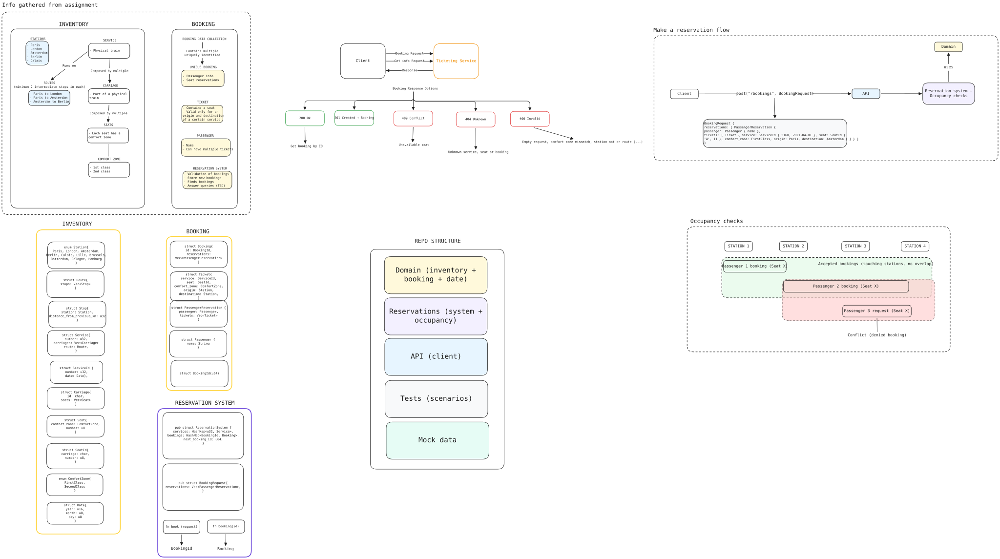

# Ticketing Service

An in-memory train seat reservation service. Books explicit seats on a train service between an origin and destination for one or more passengers. Rejects bookings for seats already taken on a given part of the itinerary.

The service exposes a REST-like interface without HTTP. Requests are plain method calls that return a status code and a body.

## Scenarios
The service relies on mocked data: stations, routes, train services, carriages, comfort zones
and seats. The model is versatile enough (while trying to keep it realistic) to support new data and new test scenarios within the given assumptions. Domain naming follows the assignment, so the code is easy to map to it.

The 4 test scenarios from the assignment, all on service 5160 on 2021-04-01:
1. Reservation for two passengers from Paris to Amsterdam in first-class seats A11 and A12.
2. The same reservation again, which fails because the seats are taken.
3. Reservation for two passengers from London to Amsterdam, one in first class and one in second class, changing seats at Paris: H1 then A1 in first class, N5 then T7 in second class.
4. The same reservation again, which fails because the seats are taken.

## How to run

Built and tested with Rust 1.100.0 (2026-11-09). No external dependencies.

```sh
cargo test                      # all unit and scenario tests
cargo test --test scenarios     # only the 4 assignment scenarios
```

The assignment scenarios are in `tests/scenarios.rs`. They use only the public API,
the same way a client would.

## Design

The code is split into three main modules, each with its own responsibility, so the boundaries between them are clear. Dependencies point one way: `api` uses `reservation`, which uses `domain`.

- **domain**: domain definitions for services and bookings
  - `inventory.rs`: types for stations, routes, services, carriages and seats (validation upon creation).
  - `booking.rs`: types for bookings, passengers and tickets.
  - `date.rs`: a simple validated date.
- **reservation**: booking validation and rules
  - `system.rs`: where bookings are created, validates every request before storing anything.
  - `occupancy.rs`: checks for conflicting seat reservations.
- **api**: the REST-like interface
  - `client.rs`: maps URLs to the reservation system and errors to status codes.
- `mock_data.rs`: the sample service data
- `tests/scenarios.rs`: the 4 assignment scenarios



Excalidraw source in [docs/design.excalidraw](docs/design.excalidraw), also exported as [PNG](docs/design.png) and [SVG](docs/design.svg).

## Decisions
- Booking IDs are sequential numbers (with crates would turn into UUIDs).
- All tickets are checked before anything is written, a failed booking does not store anything and the next booking ID is kept (all-or-nothing).
- Occupancy is verified against the tickets already in the system. There is only a conflict if the same seat is booked on overlapping parts of the itinerary. Touching stations, where one journey ends and the other starts, are not considered overlapping. The check is linear for now (it scans every stored ticket), upon scaling it would require an index (for instance by service, date and seat).
- Types that must obey rules (dates, routes, carriages and services) have private fields and validated constructors, so invalid data can't be created.
- IDs (`BookingId`, `ServiceId` and `SeatId`) are used instead of references, so bookings own their data and don't borrow from the inventory, with no lifetimes involved.
- A Service is identified by its number, `ServiceId` (number + date) identifies one run of it, which is what tickets reference.
- The comfort zone is stored on the ticket as the class sold, like a real train ticket. If the layout of the trains changes, existing tickets would still show what was sold.
- Inventory is loaded once at construction, the only runtime changes are new bookings. In production, inventory would come from an external system and be loaded when required.
- Requests reuse the domain types (`PassengerReservation`, `Ticket`) since they have the same shape. 
- Only the reservation system actually turns a request into a booking (`book()` function). Occupancy helpers are private to the reservation module. 
- The `POST` request for a new reservation takes `&mut self` because creating a booking changes state. Concurrent use would need a `Mutex` (or similar) in production.
- Error to status mapping in the REST-like client, so a new error can't be added without choosing its status code.
- Errors live in the module that produces them (no shared errors file).
- The `unwrap_used` lint is denied outside tests, so production code never panics on an error, failures are returned as errors.
- No external crates were used. For the purpose of the assignment, I preferred simplicity and used only the standard library.

## Testing
Tests are divided into two main groups: unit tests inside each module, and end-to-end tests
in [tests/scenarios.rs](tests/scenarios.rs).

- Unit tests (54, in `#[cfg(test)]` modules) are used for validation rules, edge cases and booking rules. The domain and reservation tests use their own data, so changing the mock data doesn't break them. The API tests use the mock data.
- end-to-end tests (4) use only the public API, mirroring client behavior, to run the proposed assignment scenarios. They also use the mock data.

To make sure the tests are meaningful, they use exact assertions instead of generic `is_err()`. Key parts of the code were broken on purpose to confirm that tests fail, so they don't simply always pass.

## What I'd do next
- Conductor queries. Boarding and leaving counts per station, passengers on board between stations and who sits in a given seat. The occupancy logic was written with this in mind.
- Add an index by service, date and seat so a booking only checks the tickets on its own seats instead of the current full scan.
- Concurrency so that several clients can book at the same time.
- Continuous integration with a pipeline running fmt, clippy and tests on every push.
- Share the test helpers (tickets and requests) that are currently repeated in a few test modules.

## How AI was used
AI tools (Claude, Claude Code) were used as a pair programmer to discuss design options, review my decisions and generate code from my own detailed specifications. Design and architectural decisions, assumptions and trade-offs are mine, documented above and in [ASSUMPTIONS.md](ASSUMPTIONS.md). Every change was reviewed before pushing, and the tests were checked by breaking code on purpose. Every part of it is owned by me and is my responsibility.

## Assumptions
See [ASSUMPTIONS.md](ASSUMPTIONS.md)

